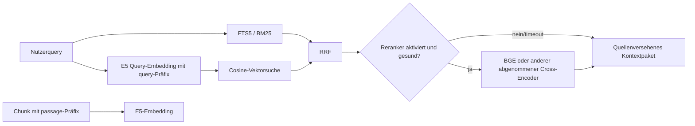

# DBZSCC – Empfehlung für lokale RAG-Backends

**Recherchezeitpunkt:** 31.10.2026  
**Status:** Finaler Synthesebericht aus Fachbefund D. Keine Modelle, ONNX-Pakete, SQLite-Extensions, Indizes oder Inferenzläufe wurden installiert, geladen, indiziert oder gemessen.  
**Versionsrahmen:** llama.cpp `b8842`; ONNX-/Python-/SQLite-Versionen auf dem Zielsystem sind absichtlich offen.

Diese Empfehlung ergänzt die [Backend- und Modellmatrix](DBZSCC_MODEL_COMPATIBILITY_MATRIX.md), verwendet die [gemeinsame Ressourcenpolicy](DBZSCC_RESOURCE_SCHEDULING_DESIGN.md) und folgt dem [Offline-/Sicherheitskonzept](DBZSCC_FAILURE_SECURITY_ANALYSIS.md).

## 1. Entscheidung

Die erste produktive RAG-Ausbaustufe soll aus **multilingual-e5-small als CPU-ONNX-Embedding-Baseline**, **SQLite FTS5**, einem **eingebetteten Vektorindex** und **Reciprocal Rank Fusion (RRF)** bestehen. `BAAI/bge-reranker-v2-m3` ist eine optionale, später zu messende Qualitätsstufe. Ein Qdrant-Service wird erst begründet, wenn ein konkreter Mehrprozess-, Skalierungs- oder HNSW-Bedarf die lokale SQLite-Basis nachweislich übersteigt.

Diese Wahl trennt Retrieval von knappen Inferenzressourcen: E5 auf `CPUExecutionProvider` belegt nicht den knappen NVIDIA-VRAM. Es konkurriert aber sehr wohl mit AMD-Vulkan0 und CPU-/Hybrid-Codern um DDR4-Bandbreite, Host-RAM und CPU-Threads; Indexierung und ONNX-Intra-/Inter-Op-Threads werden deshalb in dieselbe Ressourcenpolicy aufgenommen und bei interaktiver Inferenz gedrosselt. Sie behauptet weder eine konkrete Query-Latenz noch einen Speicherverbrauch.

## 2. Komponentenentscheidung: Tatsache, Empfehlung, Konsequenz

| Baustein | Quellenbefund | Entscheidung | Technische Konsequenz |
|---|---|---|---|
| Dense Embedding | `intfloat/multilingual-e5-small`: 12 Layer, 384 Dimensionen, ca. 0,1B Parameter, MIT, 100 XLM-R-Sprachen, bis 512 Tokens. Asymmetrisches Retrieval fordert `query: ` und `passage: `. [1] | **CPU-ONNX-Baseline** | Query exakt einmal als `query: <Text>`, jeder kanonische Chunk als `passage: <Text>`; L2-Normalisierung, Pooling, Revision und Präfixe gehören zur Indexidentität. |
| ONNX-Artefakt | Hersteller listet 470-MB-, 235-MB- und 118-MB-AVX512-VNNI-Dateien. [2] | Keine ISA-spezifische Variante ohne validierten lokalen CPU-/Kernel-Snapshot als Baseline wählen | F32/FP16-ONNX zunächst CPU-kernelkompatibel prüfen; Int8 nur mit freigegebener, für die tatsächliche CPU kompatibler Konvertierung verwenden. Dateigröße ist kein RAM-Fit. |
| Lexical Retrieval | SQLite FTS5 ist eingebautes Fulltextmodul mit BM25 und externen Content-Tabellen. [3] | **Pflichtbasis** | FTS5 liefert eigenständige, diagnostizierbare lexikale Kandidatenlisten; kein externer Dienst/Port erforderlich. |
| Vektorsuche | `sqlite-vec` bietet Windows-fähige `vec0`-Tables, ist aber pre-v1 und benötigt Extension-Loading. [4] [5] | Eingebettet, nur mit exakt hashgeprüfter Offline-Extension | Vor Einführung Python-/SQLite-/ABI-/Lizenzkompatibilität prüfen; Extension nur über vertrauenswürdigen absoluten Pfad laden und danach wieder deaktivieren. |
| Fusion | RRF kombiniert Rangplätze statt unkalibrierte BM25-/Cosine-Scores. [6] | **RRF-Standard** | Keine willkürliche Skalierung eines BM25-Scores als angeblicher Reranker. |
| Cross-Encoder | BGE-v2-M3: multilingualer 0,6B-Cross-Encoder, Apache-2.0, 24 Layer, Hidden Size 1024; offizielles Beispiel limitiert auf 512 Tokens. F32-Artefakt 2,27 GB; Community-Int8 bis 571 MB. [7] [8] | **Optional nach Qualitäts-/Ressourcenabnahme** | Nur auf kleine fusionierte Kandidatenmenge; bei Timeout oder Deaktivierung sauber auf RRF zurückfallen. |
| Qdrant | Lokaler Service benötigt Storage, Port 6333 und zusätzlichen Lebenszyklus; QdrantLocal ist für kleine Datenmengen/Demos/Tests dokumentiert. [9] [10] | Phase 1 nicht einführen | Erst bei gerechtfertigter Skalierung; keine zweite Datenhaltung aus Bequemlichkeit. |

### Planungsgrößen und Startprofil – ausdrücklich ungemessen

E5-small hat ungefähr 118M Parameter; das publizierte F32-ONNX liegt bei etwa 470 MB. Für die CPU-Session ist zunächst **0,8–1,5 GiB** zusätzlicher RAM als konservative Policyannahme einschließlich Tokenizer/Aktivierungen einzuplanen: Batch 1, ein bis zwei Intra-Op-Threads und Inter-Op 1. Eine CPU-FP16-Datei ist nicht automatisch schneller als F32. Für BGE-v2-M3 ist der FP32-Gewichtswert 2,27 GB nur eine Untergrenze; als erste CPU-Reservierung **3–5 GiB**, Batch 1, Query/Passage zunächst maximal 512 Tokens und Rerank-Top-K 10. Diese Spannen sind nicht gemessen und müssen durch Peaks ersetzt werden. CPU-Pfade beanspruchen keinen dedizierten GPU-VRAM; CUDA/DirectML erfordern eigenständige Session-/Activation-Peakprofile.

Kleinere Rerank-Alternative: `cross-encoder/mmarco-mMiniLMv2-L12-H384-v1`, multilingualer 12-Layer-Cross-Encoder, Hidden384, typischer 512-Token-Eingang. Modellgröße, konkrete Lizenz-/ONNX-Revision und kompatible Quantisierung werden vor Bereitstellung im Manifest bestätigt; hier keine abgenommene Alternative. [14] Als einfache Embedding-Alternative kann multilingualer MiniLM separat evaluiert werden, wird aber ohne eigenen Artefakt-/Qualitätsnachweis nicht als zweite Baseline eingeführt.

384D-F32-Vektoren benötigen roh 1536 Bytes je Chunk: 100.000 Chunks etwa 146,5 MiB, zusätzlich Text, Metadaten, FTS, Index und Rebuildgeneration. Das ist eine Speicherrechnung, keine Korpus- oder Performanceannahme. Kleine Korpora können einen validierten exakten, blockweisen CPU-Cosine-Pfad nutzen, wenn SQLite-Extension nicht freigegeben ist; keine Fake-Vektorsuche. Größere Korpora benötigen ein messbares Skalierungsgate.

## 3. Backend- und Gerätepolitik

ONNX Runtime unterscheidet Ausführung über Execution Providers. Die offizielle Providerliste enthält CPU, CUDA und DirectML, **aber keinen Vulkan Execution Provider**. llama.cpp-Vulkan0 ist deshalb kein ONNX-Beschleunigerpfad. [11]

| Aufgabe | Zulässiger Ausführungspfad | Verbotene Schlussfolgerung |
|---|---|---|
| E5-Embedding-Baseline | `CPUExecutionProvider` | Der AMD-Vulkan0-Worker beschleunigt ONNX. |
| Späterer ONNX-CUDA-Test | nur NVIDIA GTX 1650 SUPER, Adapter/EP loggen | Der vorhandene llama.cpp-CUDA-13.1-Build sagt etwas über ONNX-Paketkompatibilität aus. |
| Späterer ONNX-DirectML-Test | nur nach DXGI-Namensauflösung der AMD Vega 7 | `Vulkan0` belegt DirectML-Adapterindex 0. |
| llama.cpp-Vulkan | Vulkan0=AMD, Vulkan1=NVIDIA | Vulkan1 sei der AMD-Pfad oder eine zweite NVIDIA-Speicherreserve. |
| llama.cpp-CUDA | CUDA0=NVIDIA | Vega-Shared-Memory sei VRAM-Reserve für CUDA. |

DirectML verwendet DXGI-Adapterindizes, verlangt sequenzielle Sessionausführung und befindet sich laut ONNX Runtime im Sustained Engineering; die aktuelle Dokumentation verweist für neue Windows-Projekte auf WinML. Dies ist kein Grund, DirectML auszuschließen, aber ein Grund, es nicht vor CPU-Baseline und Geräteverifikation einzuplanen. [12]

## 4. Erweiterung des vorhandenen DBZS-Bestands statt Parallelarchitektur

Die Bestandsanalyse benennt bereits `local_llm_chat/workspace_indexer.py`, `document_vault.py`, `igpu_worker.py` und `workspace_db.py`. Der Indexer nutzt `ast` für Pythonmodule, Imports, Klassen und Funktionen; `DocumentVault` besitzt Format-/Chunklogik, BM25-artige In-Memory-Suche und eine optionale Rerank-Schnittstelle; `IGPUWorkerClient.rerank` arbeitet derzeit mit Wortüberlappungs-/Codeheuristik, nicht mit einem echten Modellreranker. `WorkspaceDB` ist die bestehende SQLite-Persistenz für Projekte, Sessions und Metadaten.

**Empfehlung:** Diese Pfade erweitern, nicht eine zweite Workspace-Registrierung oder eine unabhängige RAG-Datenbank einführen. Ein RAG-Index referenziert stets bestehende `project_id` und Workspacepfad. Der Indexer bleibt Quelle für Workspace-Grenzen; der Job-/Runtimepfad bleibt von Datei- und Indexverwaltung getrennt.

### 4.1 Allowlist und Ausschlüsse

Der Scanner arbeitet ausschließlich auf der explizit zugeordneten Projektwurzel und einer Datei-Allowlist. Ausgeschlossen sind mindestens `.git`, `.venv`, `venv`, `.tmp`, versteckte Verzeichnisse, `node_modules`, Caches, Buildausgaben, Backups sowie Geheimnisträger wie `.env`-Varianten, Key-/Zertifikatsdateien, Credentials-, Token- und Secretnamen. Kein ausgeschlossener Pfad, Hash, Chunktext oder Dateiinhalt darf im Index, Log oder LLM-Kontext erscheinen.

### 4.2 Chunking an Syntax- und Dokumentgrenzen

Python wird mit `ast.parse()` auf Symbolgrenzen geschnitten: Moduldocstring/Imports als Modulchunk, danach je Klasse und Top-Level-Funktion; große Methoden nur innerhalb derselben Symbolgrenze. AST-Positionen (`lineno`, `end_lineno`) erlauben nachweisbare Quellenreferenzen. [13]

TypeScript, JavaScript, C++ und QML erhalten AST-/Symbolchunking nur bei verfügbarem Parser. Ohne Parser ist ein markierter sprachspezifischer Deklarations-/Blockfallback zulässig, keine stillschweigende Regex-Qualitätsbehauptung. Markdown behält Überschriftenhierarchie und Abschnittspfad. PDF/EPUB werden nur indiziert, wenn tatsächlich extrahierter Text vorliegt – keine Platzhalter oder Bildannahmen.

Jeder Chunk trägt mindestens `project_id`, kanonischen relativen Pfad, Format/Sprache, Symbolpfad, Zeilenbereich, Chunkordinal, Import-/Elternkontext und `content_sha256` des kanonischen Textes.

## 5. Suchfluss und Ergebnisintegrität

1. Die unveränderte Nutzerquery geht in FTS5 und genau einmal als `query: `-Eingabe in E5.
2. Persistierte Vektoren entstehen nur aus `passage: <kanonischer Chunktext>` und dokumentierter Trunkierung/L2-Normalisierung.
3. FTS5 und dichte Suche erzeugen getrennte Kandidatenlisten; RRF fusioniert Ränge, keine unkalibrierten Rohscores.
4. Ein optionaler Cross-Encoder sieht nur die fusionierte kleine Query/Passage-Menge und gibt einen gesonderten Rerankscore aus.
5. Der finale Kontext enthält Text, Pfad, Symbol und Zeilenmetadaten. Bei Rerankerproblem ist die RRF-Liste der sichtbare Fallback.

`DocumentVault.search()` darf keine Heuristik mit einem Faktor wie `1.15` als „Reranking“ ausweisen. BM25, Cosine, RRF-Rang und echter Cross-Encoder-Score bleiben getrennt diagnostizierbar.

## 6. Reranking: klar abgegrenzte Qualitätsoption

BGE-Reranker-v2-M3 ist ein Cross-Encoder: Er erzeugt keinen Dokumentvektor, sondern einen Relevanzlogit für Query/Passage. Das originale F32-Weights-Artifact (2,27 GB) ist auf einer 4-GB-GTX kein Fitnachweis; Aktivierungen, temporäre Tensoren und bestehende Vision-/Runtimebelegung fehlen. Community-ONNX-Int8-Artefakte sind nur Kandidaten; ihre automatische Konvertierung ist kein Qualitäts- oder EP-Nachweis. [7] [8]

Die Reihenfolge lautet daher: E5 + FTS5 + RRF mit gelabeltem Testset etablieren; erst dann BGE v2 M3 auf kleinem Top-K prüfen. Wenn Ressourcen oder Latenz nicht akzeptabel sind, ist `cross-encoder/mmarco-mMiniLMv2-L12-H384-v1` der kleinere Kandidat für einen separaten Vergleich, nicht eine behauptete Qualitätsgleichheit. [14]

## 7. Indexgeneration, Invalidation und atomarer Swap

Der aktive Index ist unveränderlich. Ein Rebuild erzeugt eine neue Generation mit Manifest, vollständigen FTS-/Vektor-/Metadatenreferenzen und Konsistenzzählungen. Erst nach erfolgreicher Prüfung schaltet eine kurze SQLite-Transaktion `active_index_generation` um. Leser sehen damit entweder die alte vollständige oder die neue vollständige Generation; ein abgebrochener Aufbau ändert den aktiven Zeiger nicht.

Der Embedding-Fingerprint enthält mindestens Modell-ID, immutable Revision oder Artefakt-SHA-256, Tokenizer-SHA-256, ONNX-SHA-256, ONNX-Runtime-Paket/EP, Pooling, Dimension, L2-Normalisierung, Query-/Passage-Präfixe, Chunkerversion, maximale Tokens, Overlapregel und Parserversion. Jede Änderung invalidiert die passende Vektorgeneration. Bei Dateiänderung werden nur geänderte `content_sha256`-Chunks neu gerechnet; entfernte Chunk-IDs verschwinden synchron aus FTS und Vektorindex.

## 8. Offline-Artefaktvertrag

Alle später manuell bereitgestellten Artefakte benötigen ein offline lesbares Manifest mit Herkunfts-URI, Lizenz, Revision, Dateiname, Bytegröße, SHA-256, Zielpfad, Windows-x64-/Python-ABI-Kompatibilität und Freigabe. Das gilt für E5 plus Tokenizer, optionale Reranker, ONNX Runtime, `sqlite-vec`-Wheel/Extension sowie später eventuell Qdrant. Kein Codepfad lädt von Hub, Cloud oder Paketindex nach.

Der vorhandene llama.cpp-CUDA-13.1-Build beweist ausdrücklich keine Kompatibilität eines ONNX-CUDA-Pakets. CUDA-13.x wird in ONNX Runtime als Nightly-Konstellation dokumentiert; konkrete Versionen bleiben bis zur Kenntnis von Python, Treiber, CUDA/cuDNN und EP offen. [15]

## 9. Abnahme vor Umsetzung

1. Workspace- und Secret-Ausschlüsse sind mittels Auditfall nachgewiesen.
2. E5-Contract protokolliert 384 Dimensionen, L2-Normalisierung, Präfixe und wirksame Trunkierung.
3. Manifest, Lizenz, Revision und Hash passen zu lokalen Dateien; Offline-Kaltstart versucht keinen Download.
4. Gewählter EP und aufgelöster Gerätebezug werden geloggt; DirectML ist nicht aus Vulkanindex abgeleitet.
5. Ein b8842-Rerank-Pfad wird – falls gewählt – nur mit konkretem hashfixiertem Artefakt, `--embedding`, `--pooling rank`, `--reranking` und Offline-Smoketest zugelassen.
6. Ein eingefrorenes deutsch-/englisch-/Code-Testset misst Recall@K vor/nach RRF und MRR/nDCG nach optionalem Rerank; Zielschwellen werden vor Messung fachlich freigegeben.
7. Cold/Warm p50/p95 sowie FTS, Vektor, RRF, Rerank und E2E werden getrennt gemessen, ohne aus diesem Bericht Werte zu versprechen.
8. Unterbrochener Rebuild lässt alte Generation vollständig lesbar; erfolgreicher Swap hat übereinstimmende Manifest-/Chunkzählungen.

## 10. Offene Punkte

Python-/SQLite-Version und FTS5/Extension-Load-Fähigkeit, Zulässigkeit einer nativen SQLite-DLL, Freigabeprozess für Artefakte, Korpusgröße/Sprachen/Codeanteil, BGE-vs.-MMARCO-Entscheidung, verifizierte DirectML-DXGI-Zuordnung und ein tatsächlicher Mehrprozess-/Skalierungsgrund für Qdrant bleiben vor einer Umsetzung zu entscheiden.

## Quellen

[1]: https://huggingface.co/intfloat/multilingual-e5-small "intfloat multilingual-e5-small Modellkarte"  
[2]: https://huggingface.co/intfloat/multilingual-e5-small/tree/main/onnx "multilingual-e5-small ONNX-Artefakte"  
[3]: https://www.sqlite.org/fts5.html "SQLite FTS5 Dokumentation"  
[4]: https://github.com/asg017/sqlite-vec "sqlite-vec Projektseite"  
[5]: https://alexgarcia.xyz/sqlite-vec/python.html "sqlite-vec Python-Dokumentation"  
[6]: https://qdrant.tech/documentation/concepts/hybrid-queries/ "Qdrant Hybrid Queries und RRF"  
[7]: https://huggingface.co/BAAI/bge-reranker-v2-m3 "BAAI bge-reranker-v2-m3 Modellkarte"  
[8]: https://huggingface.co/onnx-community/bge-reranker-v2-m3-ONNX "ONNX Community bge-reranker-v2-m3 Modellkarte"  
[9]: https://qdrant.tech/documentation/guides/installation/ "Qdrant Installationsdokumentation"  
[10]: https://python-client.qdrant.tech/qdrant_client.local.qdrant_local "QdrantLocal API-Dokumentation"  
[11]: https://onnxruntime.ai/docs/execution-providers/ "ONNX Runtime Execution Providers"  
[12]: https://onnxruntime.ai/docs/execution-providers/DirectML-ExecutionProvider.html "ONNX Runtime DirectML Execution Provider"  
[13]: https://docs.python.org/3/library/ast.html "Python ast Dokumentation"  
[14]: https://huggingface.co/cross-encoder/mmarco-mMiniLMv2-L12-H384-v1 "MMARCO multilingual MiniLM Cross-Encoder Modellkarte"  
[15]: https://onnxruntime.ai/docs/install/ "ONNX Runtime Installationsdokumentation"
