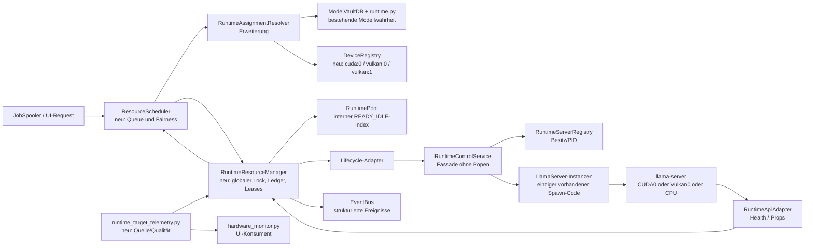
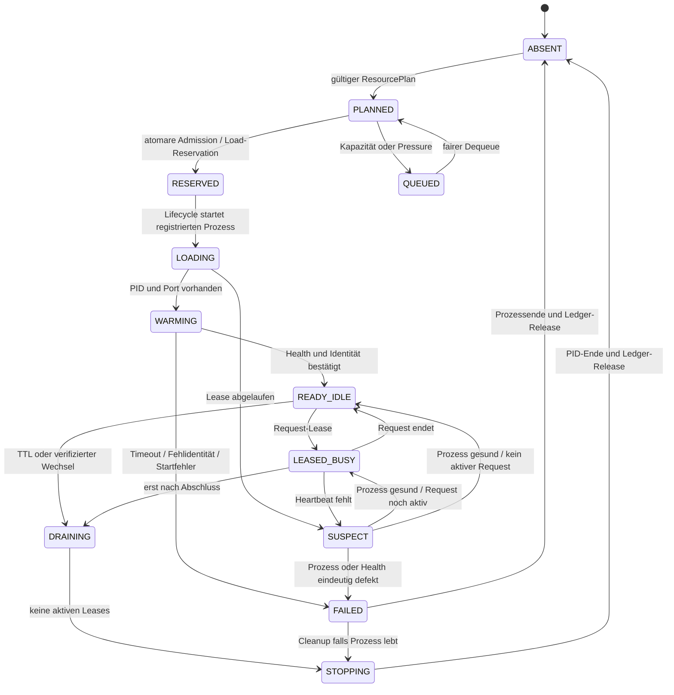

# DBZSCC – Design für deterministisches Ressourcen-Scheduling

**Recherchezeitpunkt:** 31.10.2026  
**Versionsgrenze:** llama.cpp `b8842`; aktuelle Upstream-Serverdokumentation wird nicht rückwirkend als b8842-Verhalten angenommen.  
**Status:** Finales Architektur- und Pseudocode-Design aus Fachbefund C. Keine Implementierung, keine Runtimeausführung, keine Inferenz und keine Systemänderung wurden vorgenommen.

Dieses Dokument operationalisiert die Entscheidungen aus dem [Triple-Backend-Report](DBZSCC_TRIPLE_BACKEND_RESEARCH.md) und verwendet die Modellgrenzen aus der [Kompatibilitätsmatrix](DBZSCC_MODEL_COMPATIBILITY_MATRIX.md). Sicherheits- und Offline-Controls stehen ergänzend in der [Fehler- und Sicherheitsanalyse](DBZSCC_FAILURE_SECURITY_ANALYSIS.md).

## 1. Ziel, Grenzen und Designprinzipien

DBZS benötigt eine **einzige atomare Admission-Instanz**, bevor es mehrere lokale llama.cpp-Runtimes koordiniert. Im Istzustand existieren Scanner/ModelVault, `RuntimeAssignmentResolver`, `RuntimeProfile`, Preflight, Coordinator, Prozessregistry, Adapter, Hardwaremonitor, JobSpooler und EventBus; es fehlt eine globale, nicht doppelt zählende Ressourcenreservierung. Ein paralleler Start darf deshalb nicht allein aus einer einzelnen „freien VRAM“-Anzeige abgeleitet werden.

Das Ziel ist kein abstrakter Scheduler, der Modelle selbst wählt. Die Anwendung löst eine explizite Rolle zu einer Konfiguration auf; das Scheduling entscheidet ausschließlich deterministisch, ob der erwartete Ressourcenplan jetzt **ADMIT**, **QUEUE**, **REJECT_CONFIG**, **REJECT_CAPACITY** oder **DEFER_TELEMETRY** erhält. Ein LLM darf weder Budget noch Backend noch Prozesslebenszyklus eskalieren.

Folgende Regeln sind bindend:

1. CUDA0 und Vulkan1 sind dieselbe NVIDIA GTX 1650 SUPER; 4 GiB dediziertes Device-Memory werden nur einmal bilanziert.
2. Vulkan0 ist AMD Vega 7. Deren Shared Memory ist eine View auf Host-Commit und wird nur zusätzlich gegen das DXGI-Shared-Budget geprüft – niemals als zweiter freier RAM- oder VRAM-Pool.
3. Die vorhandene AMD-Evidenz (Agents-A1, Vulkan0, 50,57 Prompt-/8,89 Generation-tok/s) ist ein abgegrenzter Auftraggebernachweis, kein Kapazitätsmodell. Der Output endete ohne Antwortabschluss; Speculation war aus.
4. Neue Arbeit wird bei Knappheit gequeued oder abgewiesen, nicht durch harten Kill eines aktiven Jobs „freigemacht“.
5. `parallel=1` bleibt gültig, bis der konkrete b8842-Build die Slot-/KV-Semantik und Peakbilanz separat belegt.

### Nutzerangabe zur Adapterrolle und typischen Displaylast (Nachtrag 03.11.2026)

**Konfigurationsannahmen des Nutzers, nicht in `Hardware.XML` gemessen:** Die AMD-iGPU betreibt die Systemmonitore; an der NVIDIA-GPU hängen keine Monitore, daher soll NVIDIA der bevorzugte dedizierte Compute-Pfad sein. Für die iGPU nennt der Nutzer 4 GiB zugewiesenen Speicher und im Durchschnitt etwa 300 MiB Displayverbrauch. Die Werte beschreiben die gemeldete Konfiguration und typische Last, nicht den aktuellen OS-/Vulkan-Budgetstand. Sie begründen insbesondere keine feste Zusage von 3,7 GiB freiem iGPU-Speicher.

Eine RAZOR-Diagnose hat AMD-iGPU und GTX 1650 SUPER als getrennte Vulkan-Geräte aufgelistet; `nvidia-smi` meldete 4096 MiB dedizierten NVIDIA-Speicher. Diese Geräteabfragen haben weder die aktiven Monitorausgänge der Adapter zugeordnet noch das iGPU-LOCAL-/NON_LOCAL-Budget gemessen. Die Rollenangabe bleibt deshalb bis zur Laufzeitprüfung eine Nutzerannahme.

Scheduler-Folgen: iGPU-Compute darf den gemeldeten Rest als **mögliche** Ressource berücksichtigen, aber nur innerhalb des aktuellen, adapterbezogenen OS-/Vulkan-Budgets und nach einer dynamischen Display-/Desktopreserve. Die berichteten 300 MiB sind ein typischer Ausgangswert, keine fixe Abzugszahl. NVIDIA wird bevorzugt, jedoch nie ohne Governor, Treiber-/Fremdprozess-Headroom oder bis zum OOM ausgereizt. CPU-Threads werden dynamisch aus aktueller CPU-Last, logischer Kapazität, verfügbarem physischem RAM und Commit-Headroom abgeleitet; hohe Last oder RAM-/Commitdruck senken das Budget und führen zu `QUEUE`/`REJECT_CAPACITY`. Unbekannte oder veraltete Telemetrie führt zu `DEFER_TELEMETRY` beziehungsweise zu einer explizit konservativen Obergrenze. iGPU, NVIDIA, CPU und RAM bilden keinen gemeinsamen VRAM-Pool; Backend- oder Multi-GPU-Verteilung bleibt unbehauptet, bis sie mit der eingebauten Runtime und realen Geräten getestet wurde.

## 2. Bestehende Verantwortung und gezielte Erweiterung

| Verantwortlichkeit | Istbestand | Erweiterung / klare Grenze |
|---|---|---|
| Modellidentität | `runtime.py`, `ModelVaultDB` | Beibehalten. Optional versionierte Peakprofile nach Modell-, `mmproj`-, Executable-, Backend-, Geräte- und Profilfingerprint ergänzen. Keine zweite Modelldatenbank. |
| Rollenauflösung | `runtime_assignment_resolver.py` | Kandidaten aus expliziten Rollen liefern; danach Admission abfragen. Resolver startet keine Prozesse, rät keine Geräte und reserviert keinen Speicher. |
| Startvertrag | `runtime_contract.py`, `RuntimeProfile` | Profil um Backend, `device_key`, Fingerprints und Policy-Version ergänzen; aktuelle Kontext-/Batch-/UBatch-/Threadwerte bleiben Planparameter. |
| Geräteinventar | nicht als bindende Schicht vorhanden | Neues kleines **`device_registry.py`** als deklaratives Inventar: Adapteridentität über verifizierte PCI-/LUID-Zuordnung binden; `cuda:0`/`vulkan:0`/`vulkan:1` sind Laufzeit-IDs, keine stabilen Hardware-IDs. Keine Zuordnung allein nach Listenreihenfolge oder Anzeigename. |
| Telemetrie | `hardware_monitor.py` für UI | Neues Qt-freies **`runtime_target_telemetry.py`** liefert Quelle, Zeit, Qualität, Fehlergrund. UI konsumiert Snapshots; geschätzte AMD-„iVRAM“-Zahlen werden nicht als Admissionwert verwendet. |
| Admission | nicht zentral vorhanden | Neues **`runtime_resource_manager.py`** ist alleiniger Besitzer von globalem Lock, Ledger, Reservations, Leases, Reconciliation und Poolindex. |
| Queue/Fairness | `job_spooler.py` besitzt Jobs, aber keine globale Hardwarequeue | Neues **`resource_scheduler.py`** hält begrenzte Queue und Fairness. Es enthält keine Hardwaremessung. |
| Prozessbesitz | `LlamaServer`, `RuntimeServerRegistry`; `DualRuntimeCoordinator` als Altpfad | `RuntimeControlService` delegiert nach Reservation an den vorhandenen LlamaServer-Owner. Coordinator wird Compatibility-Fassade ohne Popen. Registry bleibt Besitzwahrheit. |
| Health | `RuntimeApiAdapter` | `/health`, `/props`, `/v1/models` soweit unterstützt plus PID/Port/Telemetrie zu explizitem Healthresultat kombinieren. Nicht messbar = `UNKNOWN`, nicht „healthy“. |
| Ereignisse | `event_bus.py` | Strukturierte Admission-, Lease- und Healthereignisse, getrennt von flüchtigen UI-Texten. Keine Prompts, Antworten, Secrets oder vollständigen Befehlszeilen. |

`model_hardware_estimator.py` bleibt ein UI-/Fallback-Schätzer. Die bisherige pauschale Formel enthält keine Backendworkspace-Spitzen, Modellarchitektur-KV-Metadaten, Slots, gleichzeitig reservierte Runtimes oder Windows-Commit und darf deshalb nicht allein positiv admitten. `runtime_preflight.py` bleibt ein konservativer Vorfilter, ersetzt aber keine atomare Gesamtadmission.

## 3. Architektur



Das Diagramm ist eine Verantwortungszuordnung, keine Behauptung bereits vorhandener Module. Neue Dateien sind Vorschläge; vorhandene Komponenten bleiben System of Record. Insbesondere darf `DualRuntimeCoordinator` nicht eigenständig Prozesse außerhalb der Reservation starten, und der JobSpooler bleibt Runtime-Konsument.

## 4. Telemetrie- und Monitoringpolicy

### 4.1 Quellen, Identität und Qualität

| Ressourcenraum | Primärquelle | Ergänzung/Fallback | Fail-closed-Entscheidung |
|---|---|---|---|
| NVIDIA CUDA0/Vulkan1 | NVML mit UUID/PCI-/Namevalidierung plus DXGI-Budget und Nutzung für den Adapter | Runtime-Gerät über PCI/LUID validieren; der Nutzer meldet keine angeschlossenen Monitore und bevorzugte Compute-Nutzung | NVIDIA bevorzugen, aber nur innerhalb des aktuellen effektiven Budgets abzüglich verifizierter Fremdnutzung und Treiberreserve; fehlende globale Nutzung ist `UNKNOWN`, keine freie Kapazität. |
| AMD Vulkan0 (Display-iGPU) | DXGI `QueryVideoMemoryInfo` für LOCAL und NON_LOCAL/shared, nach Adapter-LUID | Laufzeitzuordnung aktiver Ausgänge via `QueryDisplayConfig`/DXGI; Nutzerangabe: 4 GiB zugewiesen, typischerweise etwa 300 MiB Displaylast | Die 300 MiB sind kein fester Abzug und 3,7 GiB keine Garantie. Compute nur innerhalb des aktuellen OS-/Vulkan-Budgets mit dynamischer Desktopreserve; AMD-Backing einmal gegen Host-Commit zählen. |
| Monitor-zu-Adapter-Zuordnung | Windows `QueryDisplayConfig` beziehungsweise DXGI-Ausgänge, auf Adapter-LUID abgebildet | Nutzerangabe ist bis zu dieser Laufzeitprüfung eine Konfigurationsannahme | Bei fehlender/veralteter Zuordnung die Displayrolle nicht als gemessen behandeln und keinen Headroom-freien GPU-Pfad zulassen. |
| Host-RAM/Commit | `GlobalMemoryStatusEx` plus `GetPerformanceInfo` | `psutil` nur UI-/`DEGRADED`-Fallback | Ohne Commitdaten keine commit-sensitive neue Host-/AMD-Admission. [4] [5] |
| Prozess/Runtime | Registry, PID, lokaler Adapter | keine Ableitung aus Netzwerkfehler | Lebende PID hält Reservation bis eindeutige Reconciliation. |

Jeder Snapshot enthält `captured_monotonic_ns`, Quelle, Adapteridentität, Fehlertext und `quality = FRESH | STALE | DEGRADED | UNKNOWN`. Monotone Zeit steuert TTL, Leases und Deadlines; Wall-clock dient nur dem Audit. Windows-Budgets sind volatil und dürfen weder als Hardwarekonstante noch als zukünftige Allocation-Garantie gelesen werden. [1] [2] [3]

### 4.2 Shared-RAM-Bilanzierung ohne Doppelzählung

Ein Ledger kennt folgende Claims:

- `host_commit_peak_mib`: Modellanteil im Host, CPU-KV, Batch/UBatch-Workspace, `mmproj`, Loader/Backend und Prozessoverhead;
- `nvidia_dedicated_peak_mib`: nur eindeutigem CUDA0- oder bewusstem Vulkan1-Device zugeordnet;
- `amd_shared_peak_mib`: Referenz auf dieselbe Hostreservation mittels `backing_reservation_id`; zusätzliche DXGI-NON_LOCAL-Prüfung, **keine** zweite Hostaddition;
- `amd_local_peak_mib`: nur wenn DXGI/Driver tatsächlich separat lokal meldet;
- `cpu_threads`, `server_slot`, `port`, `lifecycle_lease`.

```text
host_commit_total + sum(unobserved_commit_delta_by_reservation)
  + candidate.host_commit_peak + commit_safety_margin <= commit_limit

available_physical - sum(unobserved_resident_delta_by_reservation)
  - candidate.host_resident_peak - os_ui_available_guard
  >= min_available_physical

nvidia_global_used + sum(unobserved_nvidia_delta_by_reservation)
  + candidate.nvidia_dedicated_peak + nvidia_guard <= nvidia_effective_budget

amd_external_shared_estimate + sum(own_amd_shared_peak_reservations)
  + candidate.amd_shared_peak + amd_shared_guard <= amd_effective_shared_budget

cpu_thread_budget_now = conservative_cpu_budget(current_cpu_load,
    available_physical_mib, commit_headroom_mib, online_logical_threads)
sum(runtime_threads_including_candidate) <= cpu_thread_budget_now
sum(runtime_threads_including_candidate) + ui_service_thread_reserve_now <= online_logical_threads
# Hohe CPU-Last oder RAM-/Commitdruck senkt das Budget; unbekannte Telemetrie => DEFER_TELEMETRY.
```

**Keine zweite Zählung bereits sichtbarer Allokationen.** Der aktuelle Windows-Commit enthält die schon geladenen Prozesse. Deshalb wird nicht nochmals deren gesamter Peak addiert, sondern je Reservation nur der nicht beobachtete Rest: `max(0, reserved_peak - verified_observed_usage)`. Bei neuen Starts ist der Rest zunächst der volle Claim. Ohne verlässliche Prozesszuordnung darf ein Claim nicht als beobachtet ausgebucht werden; die konservative Überdeckung wird als solche ausgewiesen. Available Physical enthält die laufende OS-/UI-Last bereits; die 6-GiB-Reserve ist zusätzliche Headroompolicy, kein zweiter gemessener OS-Abzug. Commit und Resident Working Set sind getrennte Metriken. Hostplanung enthält AMD-Backing genau einmal; die AMD-Zeile ist ausschließlich die zusätzliche GPU-Budgetprüfung.

**DXGI ist kein globaler GPU-Auslastungssensor.** `QueryVideoMemoryInfo.CurrentUsage` und Budget beziehen sich auf den aufrufenden Prozess. Ein Python-Monitor darf daraus nicht die Allokation seines llama-server-Childprozesses ableiten. [1] [2] Prozessbezogene WDDM-/GPU-Process-Memory-Counter oder Runtime-eigene Messung benötigen separate Validierung und LUID/PID-Zuordnung; bis dahin bleiben Claims konservativ voll reserviert. LOCAL/NON_LOCAL sind keine universelle UMA-Shared-Aufteilung. Auf Vega muss die Segmentabbildung geprüft werden; die Admission nutzt nur tatsächlich validierte Pools. NVML-Informationen unter WDDM können teilweise nicht verfügbar sein. [3] Fehlende globale Nutzung oder unklare Fremdbelegung ist `UNKNOWN`, keine freie Kapazität. Der DXGI-Fallback allein darf somit nicht automatisch einen GPU-Start erlauben.

Ein `LlamaServer`-Objekt hält heute genau einen Prozess. Für tatsächlich parallele Server braucht die Fassade nach der seriellen Basisabnahme eine Instanz je Runtime-ID und ein injiziertes Handle im Consumer. Der Spawn-Code bleibt ausschließlich in `LlamaServer`, die Besitzregistry ausschließlich `RuntimeServerRegistry`; der Poolindex hält nur Referenzen und Leases, keine neue PID-Wahrheit.

### 4.3 Gemeinsame konservative Startpolicy

Diese Werte sind **Policyannahmen**, nicht gemessene Nutzungswerte oder Garantien:

| Parameter | Startwert | Zweck |
|---|---:|---|
| `cpu_thread_budget_now` / `ui_service_thread_reserve_now` | dynamisch; kein fester 8-Thread-Startwert | Aus aktueller CPU-Last, logischen Threads, freiem physischem RAM und Commit-Headroom ableiten; hohe Last/RAM-Druck senkt das Budget. |
| `os_ui_available_guard_mib` | 6144 | Schutzraum gegen Windows-/IDE-/Browserlast. |
| `commit_safety_margin_mib` / `min_available_physical_mib` | 4096 / 4096 | Schutz gegen Commit- und physische Speicherknappheit. |
| `nvidia_guard_mib` | mindestens 1024 MiB, zusätzlich dynamischer WDDM-/Treiber-/Fremdprozess-Headroom | Provisorische Policy-Untergrenze, kein Messwert; NVIDIA bevorzugt nutzen, aber nicht bis zum OOM ausreizen. |
| `amd_shared_guard_mib` | mindestens 2048 MiB als vorläufige Policy, plus dynamische Displayreserve | Gegen aktuelles DXGI-/Vulkan-Shared-Budget; AMD-Backing nicht doppelt gegen Host-Commit zählen. 300 MiB durchschnittliche Displaylast ist keine feste Budgetfreigabe. |
| `max_queue` / `max_queue_per_role` | 32 / 8 | Begrenzter Stau statt unbounded RAM-Queue. |
| Snapshot-/Telemetry-/Health-TTL | 2 s / 1 s / 2 s | Keine Admission auf alten Messwerten. |
| Load-/Busy-/Idle-Lease | 45 s / 5 s / 300 s | Steuerbare Ladevorgänge, Heartbeats und Pool-Lebensdauer. |
| Pressure clear / Cooldown | 3 Samples / 30 s | Hysterese gegen Flattern. |
| `parallel` | 1 | Bis b8842-Slot-/KV-Semantik und Peakprofil geprüft sind. |

## 5. Admission, Fairness und Leases

### Atomar, aber ohne langen Lock beim Prozessstart

Unter einem globalen Admission-Lock werden Snapshot und Qualität geprüft, Live-Reservations abgezogen, der Kandidatenpeak berechnet, harte Grenzen geprüft und eine persistente Reservation erzeugt. Erst danach wird der Lock verlassen und der langsame Prozessstart ausgeführt. Scheitert Persistenz oder Start, erfolgt Rollback unter demselben Lock – die Claims bleiben jedoch bis eindeutiges Prozessende reserviert.

Ein `ResourcePlan` enthält Modell-/Projectorfingerprint, Build, Backend, `device_key`, Kontext, Slotzahl, K/V-Typen, Batch, UBatch, GPU-Layer, Threads, Visionanteil und Peakherkunft. Fehlt wesentliches Architekturmetadata und keine konservative Messhistorie existiert, ist das `REJECT_CONFIG`, nicht eine erfundene Zahl.

### Queue und Nicht-Preemption

Pro Rolle/Klasse gilt FIFO mit `effective_priority = base_priority + capped_aging`, danach `enqueued_monotonic_ns` und Request-ID. Eine Rolle erhält je Runde nur eine begrenzte Startzahl, solange andere Rollen warten. Übervolle Queues ergeben `QUEUE_FULL`; abgelaufene Deadlines `DEADLINE_EXPIRED`.

Leases sind `LOAD`, `RUNTIME` und `REQUEST`. Ein abgelaufener Heartbeat bedeutet `SUSPECT`, niemals sofortige Freigabe: erst PID, Registry und Health versöhnen. Unter Druck werden nur zukünftige Starts blockiert. Aktive Jobs bleiben bis Abschluss; ein Modellwechsel setzt `DRAINING`, sperrt neue Leases und stoppt erst idle. Kill-Eskalation ist ausschließlich ein gesonderter, auditiert bestätigter Shutdown-/Korruptionspfad für eigene Prozesse – keine Scheduler-Preemption.

## 6. Zustandsmaschine



`WARMING` validiert `/health` und soweit b8842-spezifisch verfügbar `/props`/`/v1/models` gegen erwartetes Modell, Profil und Slotzahl. Nicht unterstützte Endpunkte liefern `UNKNOWN`, nicht fälschlich eine volle Identitätsbestätigung.

## 7. Neun Schritte Pseudocode

```text
01 submit(request):
       validate Schema, Rolle, Deadline, erlaubtes Backend/Target
       if deadline <= monotonic_now: return REJECT(DEADLINE_EXPIRED)
       bounded_queue.enqueue(immutable correlation_id, sequence, enqueue_ns)
       emit resource.request_queued; return QUEUED

02 scheduler_tick_or_event():
       expire requests by monotonic deadline
       request = choose(base_priority + capped_aging, FIFO, per-role quota)
       resolved = RuntimeAssignmentResolver.resolve_role(request.role)
       if invalid: finish REJECT_CONFIG
       plan = ModelRegistry.build_resource_plan(resolved, request)
       if missing metadata/calibration: finish REJECT_CONFIG

03 acquire_or_reuse(plan):
       acquire ResourceManager.global_admission_lock
       snapshots = telemetry.read_cached_or_refresh(policy.snapshot_age)
       if required telemetry UNKNOWN: release; return DEFER_TELEMETRY
       reconcile expired leases without freeing a live PID
       if exact-fingerprint READY_IDLE pool entry has slot:
           atomically reserve REQUEST lease + incremental claims; release; goto 06

04 atomically_admit_new_runtime(plan):
       keep same global lock
       derive unique host commit/resident claims, GPU views, threads, port, load lease
       add current telemetry + only unobserved reservation deltas + candidate + guards
       if any hard limit fails: record reason; release; return QUEUE or REJECT_CAPACITY
       persist reservation bundle, state RESERVED; release

05 start_and_warm(plan, reservation_id):
       lifecycle adapter may call existing start only now
       register PID through RuntimeServerRegistry
       RESERVED -> LOADING -> WARMING
       bounded health/identity check
       on success under lock: activate RUNTIME lease, state READY_IDLE
       on failure: FAILED; controlled cleanup; release claims only after confirmed PID exit

06 grant_request_lease(runtime, request):
       acquire lock; recheck health, deadline, slot and pressure
       reserve REQUEST lease, bind job/correlation, mark LEASED_BUSY
       release lock; hand endpoint to LlamaClient/JobSpooler

07 observe_while_busy(runtime, lease):
       collect heartbeat, health and telemetry with monotonic timestamps
       rate-limit structured load/pressure/stale/peak events
       pressure blocks future starts only; missing heartbeat -> SUSPECT then reconcile

08 complete_or_cancel(lease):
       validate HTTP/schema, role output, stop reason and expected final answer
       length_limited/open reasoning/unknown => incomplete; never authorize tools
       requester completes, fails or cooperatively cancels
       acquire lock; release lease and slot exactly once by lease_id
       state = READY_IDLE if healthy/no drain else DRAINING
       release; emit completion/failure without content

09 drain_and_reconcile():
       READY_IDLE past TTL or selected compatible swap -> deny new leases, DRAINING
       wait active_lease_count == 0; controlled stop
       only registry/PID-confirmed exit -> ABSENT and release linked claims
       SUSPECT/FAILED remain quarantined until ownership is conclusive
       wake scheduler after resource release, health change or fresh telemetry
```

## 8. Ereignisse, Beobachtbarkeit und Abnahme

Strukturierte Events wie `resource.admission_granted`, `resource.admission_blocked`, `resource.lease_granted`, `runtime.loading`, `runtime.ready`, `runtime.draining`, `runtime.failed`, `telemetry.stale` und `resource.pressure_changed` tragen nur Korrelation, IDs, Zustandswechsel, Fingerprints, monotone Zeit, Qualität sowie aggregierte Claims/Guards. UI-Meldungen bleiben flüchtig. Token/s ist optionales Benchmarkmaterial und niemals eine Admissionformel.

Die spätere Implementierung besteht erst, wenn sie nachweist: eindeutige DeviceRegistry-Bindung; eine einzige positive Reservation bei konkurrierenden Starts; AMD-Shared-Claim genau einmal im Host-Commit; keine erfundene NVIDIA-/AMD-Nutzung bei fehlender Telemetrie; vollständiger ResourcePlan; keine aktive Jobpreemption; Quarantäne bei lebender PID; monotone Queue/Deadline; inhaltsfreie Events; `parallel=1`-Betrieb; und korrekte Kennzeichnung der AMD-Auftraggeberwerte als externe, unvollständige Evidenz.

## 9. Offene Implementierungsfragen

1. Welcher Commit, Compiler und `--help`-Optionssatz gehört zu jedem der drei Binaries?
2. Wie wird Vulkan-Device-ID stabil mit AMD-DXGI-LUID verbunden?
3. Welche b8842-Endpunkte liefern tatsächlich Modell-/Build-/Slotidentität?
4. Welche GGUF-Metadaten und Peaks liegen für jede freizugebende Profilkombination vor?
5. Koordinieren mehrere DBZS-Prozesse dieselben Geräte; falls ja, ist ein crash-sicherer OS-weiter Lock/Transaktionsledger nötig?
6. Wann ist bei `UNKNOWN` eine manuelle, zeitlich begrenzte Ausnahme zulässig?
7. Welche Prioritäten, Deadlines und Wechselregeln gelten fachlich?
8. Welche Kill-Eskalation ist für eindeutig eigene, korrupte Prozesse organisatorisch zulässig?

## Quellen

[1]: https://learn.microsoft.com/en-us/windows/win32/api/dxgi1_4/ns-dxgi1_4-dxgi_query_video_memory_info "DXGI QUERY VIDEO MEMORY INFO structure"  
[2]: https://learn.microsoft.com/en-us/windows/win32/direct3ddxgi/dxgi-1-4-improvements "DXGI 1.4 Improvements"  
[3]: https://docs.nvidia.com/deploy/nvml-api/group__nvmlDeviceQueries.html "NVML Device Queries"  
[4]: https://learn.microsoft.com/en-us/windows/win32/api/sysinfoapi/nf-sysinfoapi-globalmemorystatusex "GlobalMemoryStatusEx function"  
[5]: https://learn.microsoft.com/en-us/windows/win32/api/psapi/nf-psapi-getperformanceinfo "GetPerformanceInfo function"  
[6]: https://docs.python.org/3/library/time.html "time Python Standard Library"  
[7]: https://raw.githubusercontent.com/ggml-org/llama.cpp/455d8e4be85aaae75195435a513a2a5dbef0136c/tools/server/README.md "llama.cpp b8842 server documentation"  
[8]: https://github.com/ggml-org/llama.cpp/issues/23158 "Windows Vulkan draft model issue mentioning b8842"
